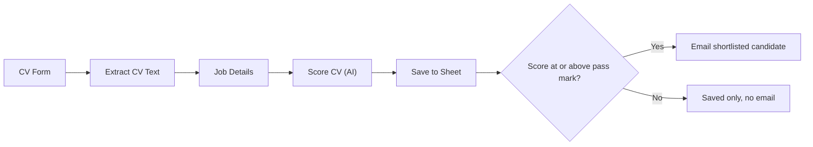

# AI CV Screener (n8n)

An n8n workflow that screens job applications with AI. Candidates apply through a form, AI scores each CV against the job requirements, every applicant is saved in a ranked Google Sheet, and candidates who reach the pass mark automatically receive a shortlist email.

> **AI scores. Rules decide. People hire.** The AI never makes the hiring decision. It helps a recruiter see the best matches first.

## What it does

1. A candidate fills in an application form (name, email, CV as a PDF).
2. The CV text is extracted from the PDF.
3. The job title, requirements and pass mark are loaded from one settings node.
4. An AI model scores the CV from 0 to 100 and returns a short summary, strengths and gaps.
5. Every applicant is saved in a Google Sheet. A second tab ranks them by score.
6. If the score is at or above the pass mark, the candidate gets an email saying they are shortlisted and that the team will get back to them with the next step.

## Workflow

<!-- Add a screenshot of your workflow here:  -->

## Tech stack

- [n8n](https://n8n.io) (form trigger, extract from file, IF, Edit Fields)
- OpenAI (Information Extractor with an OpenAI Chat Model, temperature 0)
- Google Sheets (applicant log and ranked list)
- Gmail (shortlist email)

## Nodes

| # | Node | Purpose |
|---|------|---------|
| 1 | CV Form | Application page with name, email and a PDF upload |
| 2 | Extract CV Text | Turns the PDF into plain text |
| 3 | Job Details | Stores the job title, requirements and pass mark (change this to screen another job) |
| 4 | Score CV | AI returns score, summary, strengths and gaps |
| 5 | Save to Sheet | Adds a row per applicant |
| 6 | Qualified? | IF node comparing the score with the pass mark |
| 7 | Email Qualified Candidate | Sends the shortlist email |

## Setup

1. In n8n, create a new workflow and choose **Import from file**. Select `workflow/cv-screener.json`.
2. Create a Google Sheet with a tab named **Applicants** and these headings in row 1:
   `Date, Name, Email, Job, Score, Status, Summary, Strengths, Gaps`
3. Add a second tab named **Ranked List**, with the same headings, and put this formula in cell A2:
   `=SORT(Applicants!A2:I, 5, FALSE)`
4. Open each node that shows a warning and choose your credentials (OpenAI, Google Sheets, Gmail).
5. In **Save to Sheet**, select your spreadsheet and the Applicants tab.
6. In **Job Details**, change the job title, the requirements and the pass mark.
7. In **Email Qualified Candidate**, replace `[YOUR COMPANY]` with your company name.
8. In **Extract CV Text**, make sure the input field name matches the file field name shown on the Binary tab of the form output.
9. Execute the workflow, open the form link, and upload a sample CV from `sample-data/`.

## Sample data

`sample-data/` contains three **fictional** CVs for a demo Customer Service Representative job: a strong match, a partial match, and a CV for an unrelated job. Scores can vary a little between runs.

## Responsible use

- AI can reflect bias. The prompt tells the model to ignore name, gender, age, religion, ethnicity, nationality, marital status and photos, but results should still be reviewed by a person.
- The workflow does not reject anyone automatically. Only qualified candidates are contacted, and the email says they are shortlisted, not hired.
- CVs contain personal data. Tell applicants how their CV will be used, keep the Sheet private, and only upload CVs you are allowed to use.
- For real hiring, add a recruiter approval step before emails are sent.

## Possible improvements

- Recruiter approval before the shortlist email
- A polite decline email, approved by a person
- Support for Word (.docx) CVs
- One workflow for several jobs

## Author

Built by Amarachi Confidence Owoh. Connect on [LinkedIn](https://www.linkedin.com/in/amarachi-owoh-a5aa31299).
